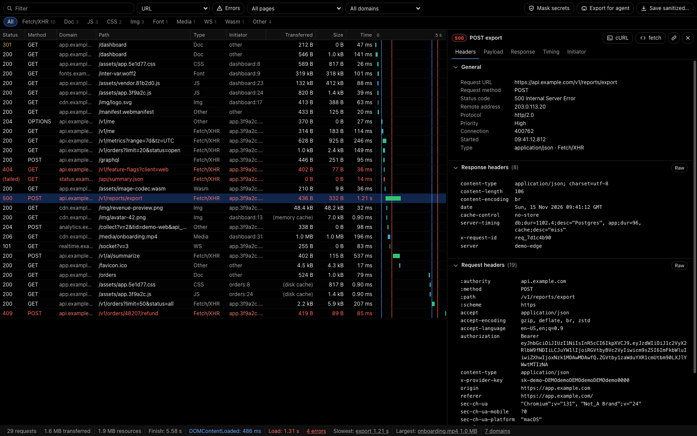

# HAR Viewer for Orca



HTTP Archive files in [Orca](https://orca.dev)'s editor tabs, opened from the file tree, a file
link in an agent chat, or `orca file open`. You get a network log like a browser's developer
tools: a fast request list with a waterfall, filters, and every request's headers, payload,
response, cookies, timing, WebSocket messages and initiator. Copy a request as cURL or `fetch`,
hand a short Markdown digest of the failed requests to a coding agent, or save a copy with known
secret patterns masked.

| Files      | What opens                                                                        |
| ---------- | --------------------------------------------------------------------------------- |
| `.har`     | **HAR Viewer**, the default view                                                  |
| `.har.zip` | **HAR Viewer**, the default view unless Archive Viewer is installed (see below)   |

It reads HAR 1.2 as Chrome, Edge, Firefox and Safari save it ("Save all as HAR"), as Playwright
records it (`recordHar`, `routeFromHAR`, `.har.zip` with `content: 'attach'`), and as agent and
proxy tools write it, including their extra fields: `_initiator` stacks, `_priority`,
`_resourceType`, `_transferSize`, `_fromCache`, `_webSocketMessages`, `_error`, base64 bodies,
timings left out or recorded as `-1`, requests without pages, and pages the file does not list.

## The list

- Columns: status, method, domain, path, type, initiator (when the file records one),
  transferred, size, time and a **waterfall** with a time scale and each page's
  DOMContentLoaded (blue) and load (red) lines. Bars show setup, waiting for the server and
  download; failed requests are red, cache hits pale.
- Click a header to sort, again to reverse, a third time for the recorded order. Columns drop
  out by priority when the pane is narrow; below 760 px the details move under the list.
- Only the rows on screen exist, so files with tens of thousands of requests scroll smoothly.
- Keys: <kbd>↑</kbd> <kbd>↓</kbd> <kbd>PgUp</kbd> <kbd>PgDn</kbd> <kbd>Home</kbd>
  <kbd>End</kbd> move through the list, <kbd>⌘F</kbd> / <kbd>Ctrl+F</kbd> goes to the filter,
  <kbd>Esc</kbd> closes the details. <kbd>Shift</kbd>-click selects a range and
  <kbd>⌘</kbd>/<kbd>Ctrl</kbd>-click adds a request, for the export (its popover says so too).
- Drag the bar between the list and the details to resize them (or focus it and use the arrow
  keys).

## Filters

- **Text**: every word must match; `-word` excludes, `"quoted phrases"` and `/regular
  expressions/` work. A menu chooses where words are looked up: the URL, the URL and headers, or
  everything including request and response bodies and WebSocket messages.
- **Properties**: `status:404`, `status:5xx`, `method:post`, `domain:api.*`, `type:js`,
  `mime:json`, `larger-than:100k`, `slower-than:1s`, `scheme:wss`, `has-response-header:etag`,
  `is:error`, `is:cached`.
- **Type chips**: All, Fetch/XHR, Doc, JS, CSS, Img, Font, Media, WS, Wasm, Other, with counts.
  A click shows one type, <kbd>⌘</kbd>/<kbd>Ctrl</kbd>-click adds another.
- **Errors**: only 4xx and 5xx responses and requests that failed.
- **Page** and **domain** menus. The domain table in the overview filters too.

## Details

- **Headers**: general facts (URL, method, status, remote address, protocol, priority, cache,
  connection, start, redirect), then response and request headers, each with a raw view.
- **Payload**: query string parameters, form fields, and request bodies as a JSON tree or
  source.
- **Response**: a JSON tree (large arrays in groups of 100), highlighted source for HTML, XML,
  JavaScript and CSS, images (SVG too) and fonts as previews, audio and video in a player that
  starts muted and never plays by itself, and a hex dump for other binary data. Response HTML is
  only ever shown as source; it is never rendered or run.
- **Cookies** sent and received, with their attributes.
- **Timing**: queueing, stalled, DNS, connection, TLS, sending, waiting and download as bars,
  plus `Server-Timing` metrics.
- **Messages** of WebSocket connections, filterable, each opened as a JSON tree or text.
- **Initiator**: the script and call stack that started the request (with async boundaries),
  the request that loaded that script, and the requests this one started.

With nothing selected the right pane shows an **overview**: totals, page timings, requests by
type and status, a per-domain table, and the slowest, largest and failed requests. The strip at
the bottom sums up what the list shows: requests, transferred and resource sizes, finish,
DOMContentLoaded and load, errors (a click toggles the errors filter), the slowest and the
largest request, and the number of domains.

## For agents

- **Copy as cURL** and **Copy as fetch** for one request.
- **Export for agent** builds a compact Markdown digest of the selected requests, the failed
  ones, or the ones in the list (at most 100): method, URL, status, timing, sizes, the
  initiator, the request headers worth reading, and bodies cut to 2,000 characters (JSON
  indented). Known secret patterns are always masked in it. Copy it, or save it as a `.md` file.

## Secrets

**Mask secrets** replaces values that match known secret patterns with `[masked]` in the view,
in copied cURL and fetch commands, and in exports, and a banner says how many values in how many
requests were masked. **Save sanitized…** writes a masked copy of the file (`.har`, or
`.har.zip` for a `.har.zip`). What counts as a secret:

- `Authorization`, `Proxy-Authorization`, `Cookie` and `Set-Cookie` values (cookie names,
  the auth scheme and cookie attributes stay), and headers named like `X-Api-Key` or
  `X-Auth-Token`;
- query parameters (in the URL and in the HAR's query string list), form fields (urlencoded,
  multipart and plain-text forms), JSON keys and HTML `meta`/`input` values named like `token`,
  `password`, `secret`, `api_key`, `session`, `csrf`, `signature`, `passcode` and similar,
  SAML messages and PKCE code verifiers;
- OAuth `code` wherever the request shows an OAuth flow: a sign-in or callback path, or
  `state`, `grant_type` or `redirect_uri` beside it, in URLs, forms and `form_post` pages;
- URLs nested in parameter values (`?next=/reset?token=…`, `redirect_uri=https%3A…`), and
  passwords in URLs;
- tokens recognisable by their shape anywhere in text, JSON keys included: JWTs, private keys
  and well-known API key formats (OpenAI, Anthropic, GitHub, GitLab, Slack, AWS, Google, Stripe
  and others).

Bodies are taken apart before they are searched: JSON is masked in place, so only the masked
values change and 64-bit integers, key order and spacing stay as they were; NDJSON, SignalR and
Socket.IO frames, and multipart parts are masked as what they hold. Any body the viewer shows as
text is masked as text, whatever its declared type, and written back the way it came (base64
stays base64, a charset stays that charset). Page titles, comments and tools' own fields are
masked as text too.

Masking works on known patterns, so review a sanitized file before sharing it: a secret with no
pattern it knows stays. Binary bodies (images, fonts, media, protobuf and other bytes that are
not text) and binary WebSocket frames that are not text are copied unchanged. A sanitized
`.har.zip` keeps only the body files its requests point to, and leaves out body files that were
not unpacked (see the budget below), since they could not be masked.

## Limits

- **Size.** Orca gives a plugin editor files of up to about 50 MiB (52,428,800 bytes). A larger
  file never reaches the viewer: Orca shows its own notice in the tab instead. A 48 MiB HAR with 9,000 requests opens in a second or
  two; masking or searching bodies in a file that size takes a moment longer. A `.har.zip` can
  hold a HAR that unpacks to up to 256 MB; its body files unpack to 256 MB each and 512 MB
  together, and a body past that says so instead of showing.
- **Search** looks at the first 2 MB of each body and of each request's WebSocket messages.
  The Messages tab lists 500 frames at a time.
- **Damaged files.** A file cut off or broken in the middle opens with the requests that could
  be read and a notice that says whether it is cut off or where it breaks (line and column),
  and how many requests were left out. A file that is not a HAR gets a message saying why.
- **Bodies in separate files.** Playwright can save bodies as files next to a `.har`. Orca
  gives editors only the file they open, so those bodies show as unavailable; record to a
  `.har.zip` (or open the `.har.zip`) to see them.
- **`.har.zip` with Archive Viewer.** When two plugins both open a file by default, Orca takes
  the one whose id comes first, whatever the length of the suffix. So with
  [Archive Viewer](https://github.com/Sergei-Popov/orca-archive-viewer) installed, a `.har.zip`
  opens as an archive, and HAR Viewer is the other choice in the tab's view switcher. Orca
  remembers that choice for the tab, not for the file type.
- Read-only: it never changes the file.

## Privacy

It works offline and makes no network requests: no telemetry, no tracking, nothing is sent
anywhere. It asks Orca for no capabilities. Saving asks you where to save every time.

## Install

From the catalog: Orca → Settings → Plugins → ⋯ → **Catalog sources…** → add
`https://github.com/Sergei-Popov/orca-plugin.git`, then install **HAR Viewer**.

From source:

```sh
git clone https://github.com/Sergei-Popov/orca-har-viewer.git
orca plugin dev load ./orca-har-viewer   # prints the access it needs and an --approve fingerprint
```

## Develop

No build step: Orca transpiles the TypeScript in `src/` on load.

```sh
orca plugin dev watch .           # load, reload on save, stream logs
orca plugin test .                # unit tests (src/**/*.test.ts)
npx -p typescript tsc -p .        # type check (after `orca plugin types .`)
orca plugin validate .
node tools/make-samples.ts        # sample files in .samples/ (git-ignored)
orca plugin shot local.har-viewer --editor .samples/demo.har   # PNG of the editor
```

- `src/editor.ts` — the custom editor entry: text or bytes document → `HarApp`; `src/hello.ts`
  holds the strings back until Orca has said which language it uses.
- `src/ui/` — the view: `app.ts` (toolbar, filters, selection, masking, saving), `list.ts`
  (virtualized list and waterfall), `details.ts` (tabs), `viewers.ts` (JSON tree, source, hex,
  media), `overview.ts`, `export.ts`, `choices.ts` (menu choices), `common.ts`; `src/styles.ts`, `src/icons.ts`,
  `src/i18n.ts`, `src/dom.ts`, `src/format.ts`, `src/highlight.ts`.
- `src/har/` — DOM-free and tested: `read.ts` (tolerant reading of cut-off and damaged JSON),
  `model.ts` and `classify.ts`, `body.ts`, `zip.ts` (`.har.zip`), `query.ts` (filters and
  sorting), `summary.ts`, `headers.ts`, `copy.ts` (cURL, fetch), `digest.ts` (the Markdown
  digest), `frames.ts` (WebSocket frames), `json-text.ts` (JSON as text: lossless indenting),
  and masking: `sanitize.ts` (entries and the HAR), `mask-body.ts` (JSON in place, forms,
  multipart, frames, byte bodies), `mask-url.ts` (URLs, parameters, free-text fields),
  `mask-text.ts` (names, token shapes, free text) and `masked.ts` (with `.har.zip` files).
- `src/fixtures/demo.ts` — the synthetic demo recording the tests, samples and screenshots use.
- `tools/` — `make-samples.ts` and `rasterize-icons.sh` (icons from `icons/har.svg` and
  `images/icon.svg`).
- `vendor/` — [fflate](https://github.com/101arrowz/fflate) 0.8.3 (MIT) for `.har.zip`; see
  `vendor/README.md`.

Branches follow git-flow: `feature/*` from `develop`, releases through `release/x.y.z` into
`main`, tagged `vX.Y.Z`. Only the maintainers push and open pull requests.

## License

MIT © Sergei Popov, except `vendor/fflate/` — MIT (`vendor/fflate/LICENSE`).
